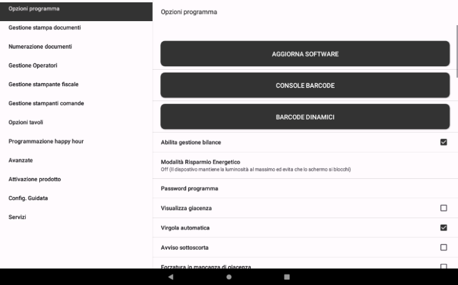
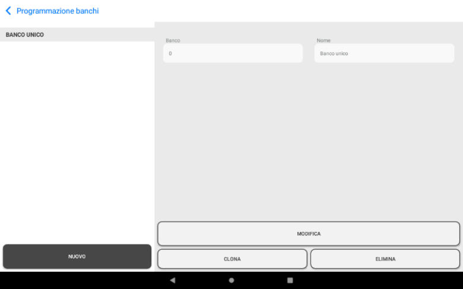
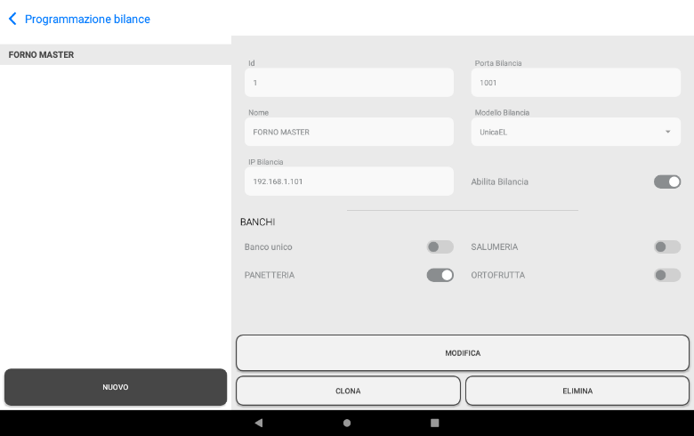
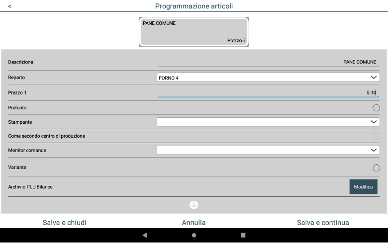
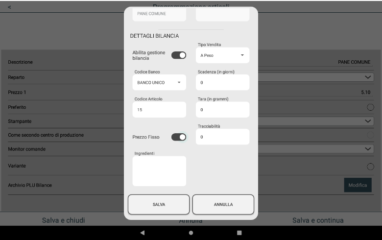
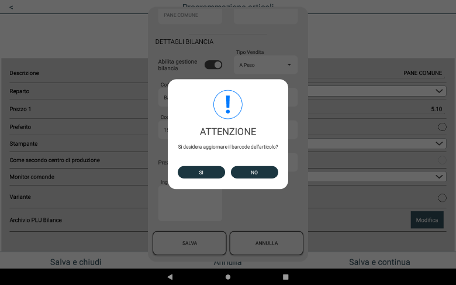
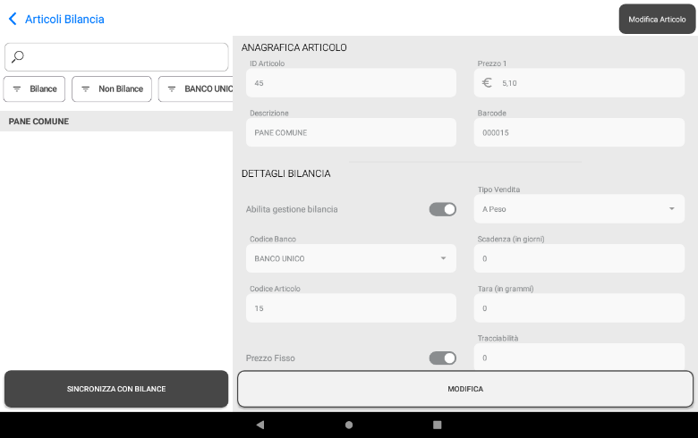

# Configurazione KeepUp Smart

## Parametro generale

Per abilitare le funzionalità di invio anagrafiche alle bilance, accedere a **Impostazioni > Opzioni programma**, quindi attivare il parametro **"Abilita gestione bilance"**.

## Anagrafica Banchi

La gestione banchi permette di suddividere l'archivio PLU in modo da trasmettere selettivamente gli articoli alle sole bilance facenti parte del banco.

- La medesima bilancia può far parte di uno o più banchi (vedi [Anagrafica Bilance](#anagrafica-bilance)).
- Qualora non si intenda gestire i banchi, creare il banco "0" e associare a esso tutti gli articoli.

Per creare o modificare i banchi accedere a **Archivi > Bilance > Banchi**.

## Anagrafica Bilance

Per censire le bilance presenti nel punto vendita, accedere a **Archivi > Bilance > Bilance**.

Per ciascuna bilancia occorre indicare i seguenti parametri:

| Parametro | Descrizione |
|-----------|-------------|
| **Id** | Assegnato automaticamente dal software, non è modificabile |
| **Nome** | Descrizione della bilancia |
| **Porta** | Porta TCP di comunicazione come programmata sulla bilancia (vedi [Configurazione di rete bilancia Unica](anagrafica-configurazione-unica.md)). Per i modelli Unica Touch impostare la porta **9002** |
| **Modello** | Scegliere tra Unica EL e Unica R |
| **IP** | Indirizzo di rete TCP/IP della bilancia (vedi [Configurazione di rete bilancia Unica](anagrafica-configurazione-unica.md)) |
| **Abilita** | Permette di disabilitare la bilancia senza rimuoverne la configurazione (ad esempio se viene temporaneamente tolta dal sistema) |
| **Banchi** | Associare uno o più banchi tra quelli disponibili (vedi [Anagrafica Banchi](#anagrafica-banchi)) |

## Anagrafica Articoli

Sono disponibili due modalità per la gestione dei dati anagrafici specifici per le bilance.

### Archivio Articoli

1. Accedere a **Archivi > Articoli**.
2. Gestire i dati dell'articolo come di consueto: descrizione, prezzo, reparto (per l'associazione con l'aliquota IVA) e gli altri parametri (fare riferimento al manuale utente di KeepUp Smart).
3. Sulla riga **Archivio PLU Bilance** toccare il pulsante **Modifica**.

!!! note "Prezzo inviato alla bilancia"
    Il prezzo verrà inviato alla bilancia come **prezzo al kg** per i prodotti da pesare, come **prezzo unitario** per i prodotti da vendere a quantità digitata.

Se sono in corso modifiche (o in fase di creazione di un articolo nuovo) viene richiesto di eseguire il salvataggio per poter proseguire.

Apparirà la schermata con i dati specifici per le bilance:

| Campo | Descrizione |
|-------|-------------|
| **Abilita** | Abilita l'invio dell'articolo alle bilance del negozio |
| **Banco** | Selezionare un banco tra quelli esistenti (vedi [Anagrafica Banchi](#anagrafica-banchi)) |
| **Codice Articolo** | Indicare il codice PLU da usare in bilancia per richiamare l'articolo; il codice PLU è univoco all'interno del banco |
| **Tipo vendita** | Scegliere tra "a peso" oppure "al pezzo" |
| **Scadenza (giorni)** | Impostare il numero di giorni per il calcolo della data di scadenza (per stampa in modo "scontrino singolo" o "etichetta") |
| **Tara (grammi)** | Impostare il numero di grammi per la tara preimpostata associata all'articolo; impostare il valore 0 nel caso non si voglia gestire la tara preimpostata |
| **Tracciabilità** | Valore per abilitare, o meno, in bilancia la richiesta dei dati del lotto; fare riferimento al manuale della bilancia |
| **Ingredienti** | Testo ingredienti (per stampa in modo "scontrino singolo" o "etichetta") |

#### Generazione automatica del barcode

Qualora non sia stato impostato manualmente un barcode, verrà proposto di crearne uno automaticamente, in un formato idoneo per la successiva fase di vendita tramite [lettura del QR Code](qrcode-introduzione.md).

Il barcode avrà la struttura **BBPPPP**, con BB = Banco e PPPP = PLU nel banco.

!!! tip "Esempio"
    Per il PLU 15 del banco 2 il barcode generato automaticamente sarà `020015`.

### Archivio Articoli Bilancia

A differenza della modalità precedente, questa funzionalità non permette la creazione di nuovi articoli in anagrafica, ma di associare i dati bilancia ad articoli esistenti.

Accedere a **Archivi > Bilance > Articoli Bilancia**.

- È possibile cercare gli articoli esistenti applicando i filtri indicati (solo articoli destinati a bilance, solo articoli non destinati a bilance, solo articoli di un determinato banco) e/o tramite la descrizione.
- Una volta selezionato l'articolo nella colonna di sinistra, toccando **"Modifica"** sarà possibile modificarne i dati specifici per la bilancia, mentre toccando **"Modifica articolo"** sarà possibile modificarne i dati principali (descrizione, reparto, prezzo, ecc.).
