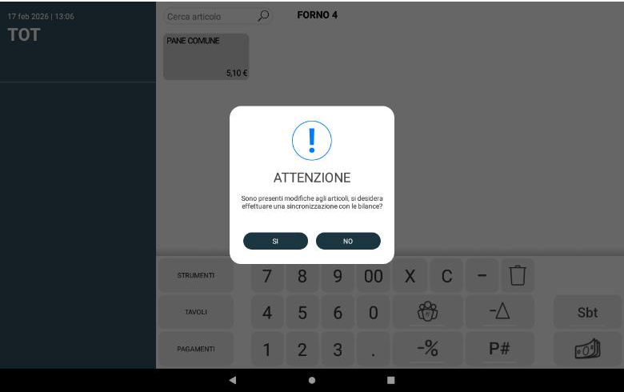
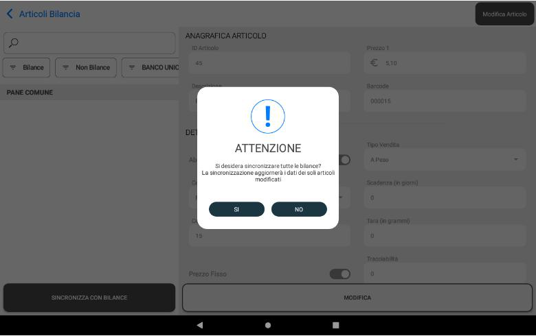
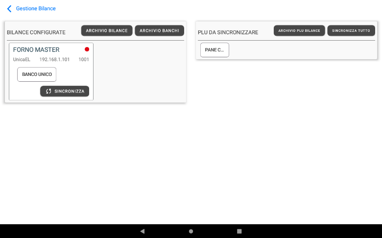
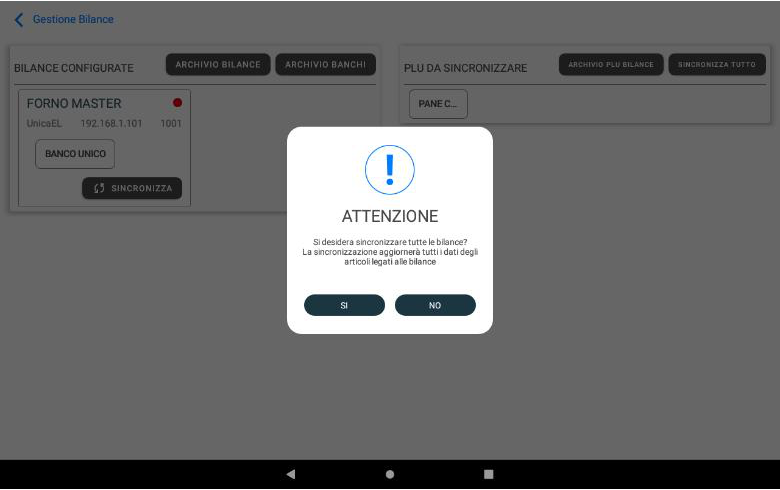

# Trasmissione dati da KeepUp Smart verso bilance

## Invio dei soli articoli modificati

Ogni volta che si entra in modalità **"Cassa"** viene verificato se sono presenti dati di articoli modificati da trasmettere alle bilance configurate, e viene proposto di eseguire la sincronizzazione con esse.

Qualora venisse risposto **NO**, oppure qualora una o più bilance non avessero ricevuto correttamente i dati (es. perché spente o offline), rimarrà visibile un segnalatore come promemoria dell'attività da completare:

Toccando il segnalatore verrà riproposta la trasmissione.

### Invio da Articoli Bilancia

In alternativa all'accesso alla modalità "Cassa", è possibile effettuare l'invio degli articoli variati anche accedendo a **Archivi > Bilance > Articoli Bilancia**, quindi toccando **"Sincronizza bilance"**.

## Invio completo dell'intera anagrafica articoli

Per ritrasmettere l'intera anagrafica articoli a una bilancia, ad esempio in caso di riparazione o di cancellazione del suo archivio, accedere a **Impostazioni > Servizi > Gestione Bilance**.

Da questa schermata è possibile vedere lo stato delle bilance configurate e accedere rapidamente agli archivi dei banchi, delle bilance e degli articoli.

Toccando **"Sincronizza tutto"** è anche possibile ritrasmettere tutti gli articoli a tutte le bilance.

!!! note "Quando serve l'invio completo"
    L'invio completo è necessario anche dopo la cancellazione dell'archivio PLU in bilancia (funzione 86), ad esempio a seguito dell'errore "Memoria Piena": vedi [Configurazione di rete bilancia Unica](anagrafica-configurazione-unica.md#errore-memoria-piena).
