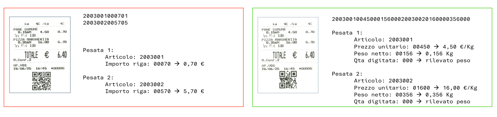

# Conformità fiscale e QR Code Free Form

## Maggior conformità fiscale per i corrispettivi

Viene identificata in modo corretto ogni aliquota IVA, per la creazione dei documenti commerciali e l'invio giornaliero dei corrispettivi all'Agenzia delle Entrate, **superando la Ventilazione IVA**.

!!! tip "Un esempio concreto"
    Ciò è **vantaggioso**, ad esempio, per forni e panifici che acquistano prevalentemente ingredienti al 10% e vendono principalmente pane al 4%: la ventilazione IVA porterebbe a versare un'IVA a debito superiore a quella che risulterebbe da una gestione puntuale delle singole aliquote di vendita.

## Maggior conformità fiscale per le fatture

**Inclusione dei dati obbligatori**: il sistema assicura che le fatture riportino correttamente, per ciascuna pesata:

| Dato | Significato |
|------|-------------|
| **Natura** | Aliquota IVA |
| **Qualità** | Descrizione dettagliata del prodotto |
| **Quantità** | Peso netto oppure numero di pezzi digitati in bilancia |

Anche in caso di **forzatura del prezzo** applicata al banco, il prezzo unitario corretto viene inserito nel QR Code affinché arrivi in cassa e compaia correttamente in fattura, garantendo la coerenza del documento finale.

## Confronto tra QR Code "Free Form" e QR Code con elenco di EAN

Vantaggi del Free Form rispetto a un QR Code che contenga solo una lista sequenziale di EAN generati dalla bilancia:

- **interpretazione corretta delle quantità vendute** (peso netto o quantità digitate), senza ricalcoli al punto cassa che porterebbero a errori di arrotondamento e a errori dovuti all'uso di un diverso prezzo unitario;
- **utilizzo del prezzo unitario usato dalla bilancia al momento della pesata** (non del prezzo di anagrafica in cassa al momento della lettura).



### Esempio: stesso scontrino, due contenuti diversi

Scontrino con due pesate: pane comune (0,156 kg a 4,50 €/kg = 0,70 €) e pizza margherita (0,356 kg a 16,00 €/kg = 5,70 €).

**QR Code con elenco di EAN**

```
2003001000701
2003002005705
```

| Pesata | Articolo | Importo riga |
|--------|----------|--------------|
| 1 | 2003001 | 00070 → 0,70 € |
| 2 | 2003002 | 00570 → 5,70 € |

**QR Code Free Form**

```
2003001004500015600020030020160000356000
```

| Pesata | Articolo | Prezzo unitario | Peso netto | Quantità digitata |
|--------|----------|-----------------|------------|-------------------|
| 1 | 2003001 | 00450 → 4,50 €/kg | 00156 → 0,156 kg | 000 → rilevato peso |
| 2 | 2003002 | 01600 → 16,00 €/kg | 00356 → 0,356 kg | 000 → rilevato peso |

!!! note "Nota"
    Con l'elenco di EAN alla cassa arriva soltanto l'importo di riga; con il Free Form arrivano prezzo unitario, peso netto e quantità digitata di ogni pesata.
