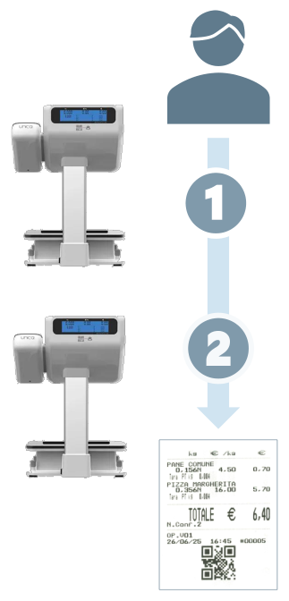

# Funzionalità avanzate al banco

## Forzatura prezzo in bilancia

- Per ciascun PLU, KeepUp Smart invia alle bilance un parametro che consente, o meno, all'operatore di modificare il prezzo per una singola operazione.
- La modifica è **momentanea**: non altera l'anagrafica e si applica solo alla pesata/digitazione successiva. Il **prezzo unitario modificato** viene **trasferito alla cassa** nel QR Code.

!!! tip "Esempio"
    Il titolare dell'attività può applicare prezzi ridotti a clienti affezionati, mentre un dipendente può essere limitato dal sistema.

## Modalità di vendita: pesata o digitazione quantità

Il sistema gestisce sia i **prodotti "a peso"** sia quelli venduti **"a pezzo"** (es. spiedini, croissant, carciofi).

- KeepUp Smart mantiene questa distinzione nell'anagrafica e la invia alle bilance.
- La bilancia applica la modalità corretta al richiamo del PLU e inserisce la quantità digitata nel QR Code al posto del peso netto.
- In cassa, l'articolo viene aggiunto con prezzo unitario e quantità per il documento commerciale o la fattura.

## Pesate "a passaggio" (Master/Slave)

È possibile configurare più bilance nel medesimo banco tramite collegamento diretto tra loro, per servire il cliente da **più postazioni** con un **unico scontrino cumulativo**.

- L'operatore pesa su bilance diverse. Al termine, da una bilancia totalizza e stampa un solo scontrino con QR Code che racchiude tutto il percorso di acquisto.
- KeepUp Smart invia i dati anagrafici alla bilancia master, che si occupa di allineare le slave.

## Etichettatura prodotti confezionati

Il sistema può trasmettere alla bilancia anche i dati necessari per la creazione di etichette, semplificando il confezionamento dei prodotti.

- Testo ingredienti inviato direttamente da KeepUp Smart.
- Data di scadenza calcolata automaticamente dalla bilancia attraverso i "giorni di conservazione" impostati in anagrafica articolo.
- Stampa in layout etichetta (con barcode EAN13) o scontrino singolo (con QR Code).

Una versatilità ideale per sfruttare la medesima bilancia sia per l'etichettatura di prodotti preconfezionati sia per la vendita a libero servizio.

!!! note "Dove si impostano questi dati"
    Tipo di vendita, scadenza, tara, tracciabilità e ingredienti si impostano nell'anagrafica articolo: vedi [Configurazione KeepUp Smart](anagrafica-configurazione-kus.md#anagrafica-articoli).
