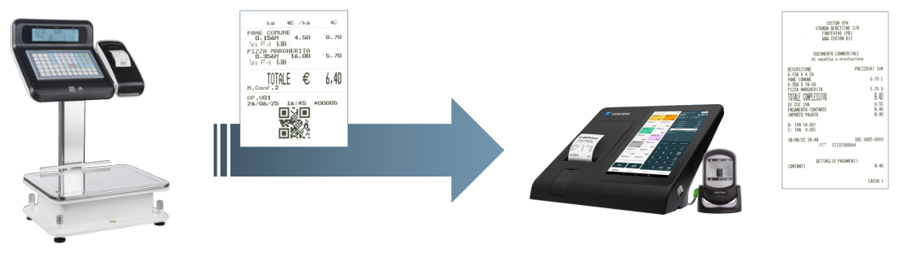

# KeepUp Smart e bilance Unica

**Semplice. Veloce. Affidabile.**

Questo corso presenta la soluzione integrata tra la app di cassa **KeepUp Smart** e la famiglia di bilance **Unica**: un sistema che semplifica la gestione delle anagrafiche dei prodotti per tutte le attività che utilizzano bilance, e delle vendite quando le bilance stampano scontrini cumulativi con più pesate.

## I due flussi della soluzione

| Flusso | Cosa fa | Come avviene |
|--------|---------|--------------|
| **Da cassa a bilance** | Articoli, prezzi e parametri vengono gestiti una sola volta in KeepUp Smart e distribuiti a tutte le bilance del negozio | Invio diretto tramite rete locale (Ethernet), senza PC o software intermedi |
| **Da bilance a cassa** | Tutte le pesate dello scontrino cumulativo vengono trasferite alla cassa in un solo passaggio | Lettura con scanner 2D del QR Code stampato dalla bilancia, anche senza collegamento tra i dispositivi |

## Struttura del corso

### La soluzione

1. [Panoramica](panoramica.md) — a chi si rivolge, quali problemi risolve e come funzionano i due flussi.
2. [Conformità fiscale e QR Code Free Form](conformita-fiscale.md) — corrispettivi, fatture e confronto con il QR Code a elenco di EAN.
3. [Funzionalità avanzate al banco](funzionalita-banco.md) — forzatura prezzo, vendita a peso o a pezzo, pesate "a passaggio", etichettatura.
4. [Integrazione con Inventa Backoffice](inventa-backoffice.md) — anagrafiche da remoto, magazzino e statistiche.
5. [Scenari di applicazione](scenari.md) — dal negozio con una cassa e una bilancia fino a più negozi.
6. [Benefici e vantaggi](benefici.md) — il riepilogo per il negoziante.

### Configurazione: anagrafica articoli da cassa a bilance

1. [Introduzione e logiche di sincronizzazione](anagrafica-introduzione.md)
2. [Configurazione KeepUp Smart](anagrafica-configurazione-kus.md) — parametro generale, banchi, bilance, articoli.
3. [Configurazione di rete della bilancia Unica](anagrafica-configurazione-unica.md)
4. [Trasmissione dati alle bilance](anagrafica-trasmissione.md)

### Configurazione: pesate multiple in cassa tramite QR Code

1. [Introduzione](qrcode-introduzione.md)
2. [Configurazione KeepUp Smart](qrcode-configurazione-kus.md) — barcode dinamici e articoli.
3. [Configurazione bilancia Unica](qrcode-configurazione-unica.md)
4. [Configurazione bilancia Icona](qrcode-configurazione-icona.md)

## Materiali e risorse

Presentazione, documenti tecnici, flyer, video, flashcard e quiz sono raccolti nella pagina [Materiali e risorse](materiali.md).

!!! note "Compatibilità"
    La soluzione è compatibile con **Unica EL** e **Unica R**, sia con tastiera meccanica, a membrana o touchscreen.
