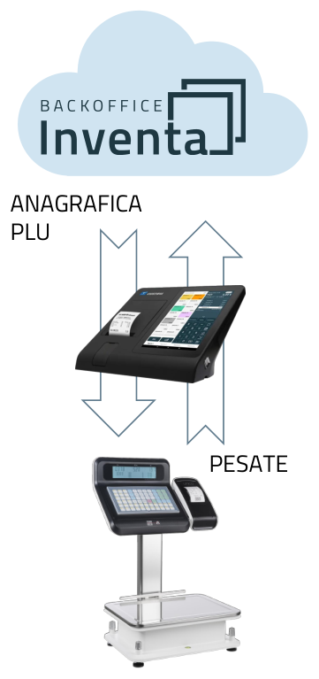

# Integrazione con Inventa Backoffice

Integrando, opzionalmente, il sistema con **Inventa Backoffice** si ottiene:

- **Gestione remota delle anagrafiche**: KeepUp Smart può ricevere i dati degli articoli e i prezzi direttamente dal cloud o da un server remoto tramite Inventa.
- **Distribuzione automatica**: una volta ricevute le anagrafiche dal cloud, il sistema le inoltra alle bilance del punto vendita.
- **Nessun PC in negozio**: grazie a questa comunicazione diretta tra cloud e sistema di cassa/bilance, viene definitivamente eliminata la necessità di avere un PC ausiliario o software gestionali complessi installati fisicamente nel negozio.
- **Gestione del magazzino e statistiche**: l'integrazione permette, al termine della vendita, di trasferire il peso netto rilevato in bilancia al sistema di backoffice senza ricalcoli, garantendo una gestione precisa del magazzino e la generazione di statistiche di vendita affidabili.

!!! note "Nota"
    L'abbinamento con Inventa è opzionale. Lo scenario con più negozi collegati a Inventa Backoffice è illustrato nella pagina [Scenari di applicazione](scenari.md#scenario-4-piu-negozi-con-inventa-backoffice).
