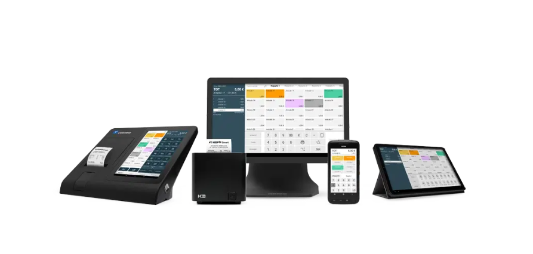
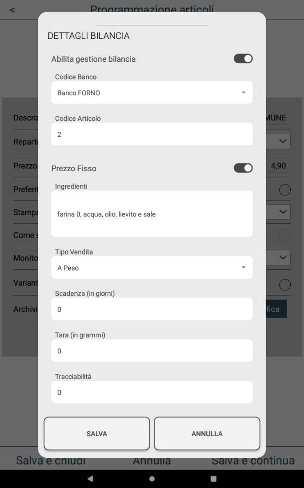
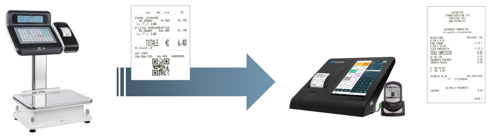

# Panoramica

## 2 protagonisti, 1 sistema, 0 complicazioni

Una soluzione integrata tra la app **KeepUp Smart** e la famiglia di **bilance Unica**.

Un sistema efficiente che semplifica drasticamente la gestione delle **anagrafiche dei prodotti** per tutte le attività che utilizzano bilance, e delle vendite quando stampano **scontrini cumulativi con più pesate**.

È un *must-have* per **panetterie, forni, pasticcerie, salumerie/formaggi, pescherie, macellerie, gastronomie** e negozi di **prodotti ortofrutticoli**.

!!! note "Compatibilità"
    Compatibile con **Unica EL** e **Unica R**, sia con tastiera meccanica, a membrana o **touchscreen**.

## Oltre la complessità dei sistemi disconnessi

Molti punti vendita gestiscono ancora bilance e casse come entità separate, con queste conseguenze:

- doppia gestione dei prezzi;
- scontrini disallineati.

Oppure dipendono da PC ausiliari per farle dialogare, con:

- elevati costi di gestione, anche in caso di fermo di sistema.

Con **KeepUp Smart** la cassa diventa il **centro di governo delle bilance**: articoli, prezzi e parametri vengono gestiti una sola volta e distribuiti a tutte le bilance del negozio, senza computer aggiuntivi, software intermedi o operazioni manuali.

## Da cassa a bilancia

### Gestione anagrafica articoli

- L'anagrafica di cassa è stata **estesa** per gestire codice PLU, modalità di vendita, tara preimpostata e altre caratteristiche specifiche per le bilance.
- Aggiornamenti immediati di articoli, prezzi e descrizioni dal punto cassa.
- Senza computer aggiuntivi, software intermedi o operazioni manuali ripetitive: **l'invio è diretto** tramite collegamento **Ethernet** tra punto cassa e bilance.
- Possibilità di organizzare le bilance in **banchi**, con assegnazione mirata degli articoli.
- Possibilità di aggiornare contemporaneamente più bilance, anche di **modello differente** tra loro.

!!! tip "Approfondimento"
    La procedura completa è descritta nella sezione [Anagrafica da cassa a bilance](anagrafica-introduzione.md).

## Da bilance a cassa

### Velocità e precisione alla cassa

- La **bilancia** stampa un **unico scontrino cumulativo che include un QR Code** contenente tutte le informazioni essenziali per ogni articolo venduto: PLU, peso netto o quantità, prezzo.
- Al **punto cassa** con KeepUp Smart, una rapida scansione del QR Code con un lettore 2D (come il Custom SM600) **completa la transazione in un solo passaggio**.

In sintesi:

- un solo QR Code da leggere per trasferire tutte le pesate, con risparmio di carta;
- peso e prezzo comunicati senza arrotondamenti o alterazioni;
- nessun tempo di attesa per il trasferimento dei dati;
- continuità operativa garantita anche offline: tutte le informazioni sono contenute nel QR Code.

!!! tip "Approfondimento"
    La procedura completa è descritta nella sezione [Pesate in cassa con QR Code](qrcode-introduzione.md).
