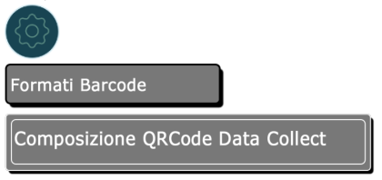
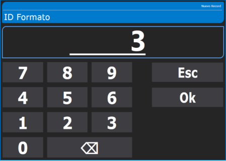
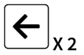
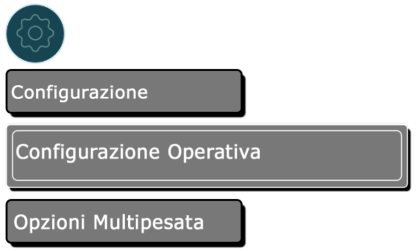
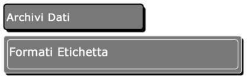
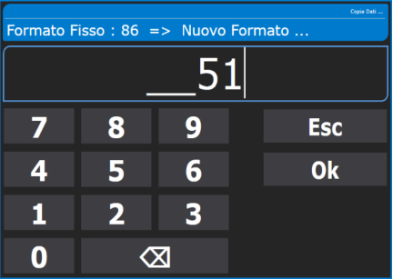
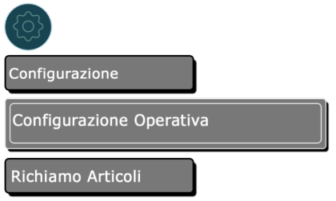
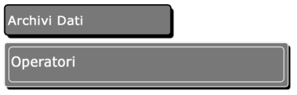

# Configurazione bilancia Icona

!!! note "Limite di vendite per scontrino"
    Con la bilancia Icona il limite massimo di vendite per scontrino è di 35: superandolo, il QR Code non verrà stampato.

## Configurazione QrCode

1. Dalla "Pagina Iniziale" premere:

    

2. Per creare una nuova sequenza di QR Code Data Collect, premere il tasto 
3. Inserire il numero ID tramite il tastierino numerico (es. 3) e confermare con OK.

    

4. Inserire una descrizione per identificare la programmazione:

    

5. Spostarsi nella sezione:

    

6. Selezionare il campo **Body** e inserire la stringa `r07n05o05s03`:

    

7. Uscire premendo due volte il tasto 

## Impostazione Barcode

1. Dalla "Pagina Iniziale" premere:

    

2. Selezionare la voce **"Barcode => QR Code Datacollect"** e impostare il numero precedentemente programmato:

    

3. Impostare il parametro **"Barcode => Vendita"** in base a come viene generata l'anagrafica PLU:

    | Caso | Valore |
    |------|--------|
    | Nessun gestionale collegato alla bilancia: i PLU vengono programmati manualmente | **106** |
    | Articoli generati da un software esterno | **100** |

    

    

4. Uscire tramite il tasto 

## Formato di stampa

1. Spostarsi in:

    

2. Premere il tasto dei formati fissi presenti nella memoria della macchina: 
3. Scorrere l'elenco fino alla posizione **86 "CODA SCONTRINO QrCode"**, selezionarlo e premere il tasto 
4. Inserire il codice **51**, sovrascrivendo quello presente in memoria.

    

5. Uscire tramite il tasto 

## Operazioni aggiuntive

Per evitare vendite a prezzo libero, sconti manuali sugli articoli e operazioni in detrazione che potrebbero compromettere la lettura del QR Code in cassa, è necessario bloccare la possibilità di eseguire tali operazioni.

### Vendita solo tramite richiamo articolo

1. Dalla "Pagina Iniziale" premere:

    

2. Impostare la modalità di richiamo in:

    

3. Uscire tramite il tasto 

L'opzione vincolerà lo strumento a vendere solo tramite il richiamo di un articolo. È possibile anche impostare un eventuale numero di cifre dopo il quale lo strumento richiama in automatico l'articolo senza premere il tasto PLU.

### Disattivazione di sconti, resi e vendite in sottrazione per operatore

1. Spostarsi nella sezione:

    

2. Selezionare dall'elenco il primo operatore in lista e accedere alla programmazione.
3. Spostarsi nella sezione:

    

4. Disattivare i parametri **Utilizzo Sconti**, **Utilizzo Resi** e **Vendite in Sottrazione**:

    

5. Uscire tramite il tasto 

!!! note "Nota"
    Lo strumento di default non ha operatori programmati: se l'elenco dovesse risultare "vuoto", creare gli operatori che saranno utilizzati con queste opzioni disattivate.
