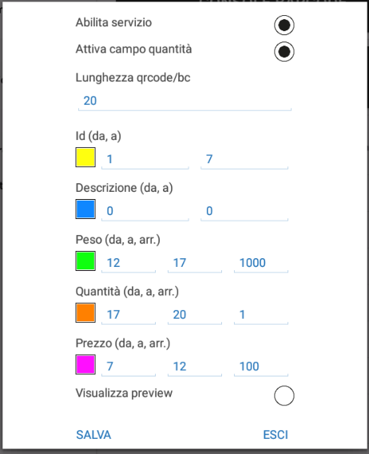
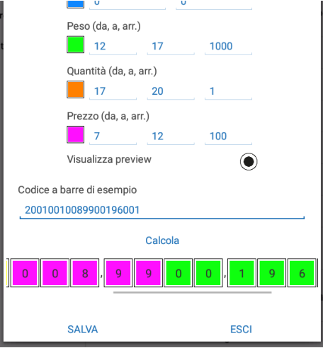
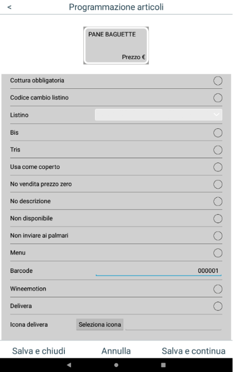

# Configurazione KeepUp Smart

## Configurazione "barcode dinamici"

1. Dalla schermata di vendita premere il tasto "Back", poi entrare nella sezione **"Impostazioni"**.
2. Nella pagina **"Opzioni programma"** premere il pulsante **"BARCODE DINAMICI"**.
3. Nella schermata di configurazione che apparirà, inserire i parametri come mostrato.

| Parametro | Valore |
|-----------|--------|
| Abilita servizio | Attivo |
| Attiva campo quantità | Attivo |
| Lunghezza qrcode/bc | 20 |
| Id (da, a) | 1 – 7 |
| Descrizione (da, a) | 0 – 0 |
| Peso (da, a, arr.) | 12 – 17 – 1000 |
| Quantità (da, a, arr.) | 17 – 20 – 1 |
| Prezzo (da, a, arr.) | 7 – 12 – 100 |

### Verifica con "Visualizza preview"

Se lo si desidera è possibile abilitare **"Visualizza preview"** e usare il campo di testo che apparirà per effettuare una prova di lettura del QR Code con lo scanner, verificando che venga correttamente visualizzato con i colori e i decimali.

Al termine confermare premendo **"SALVA"**.

## Configurazione articoli

Ogni articolo programmato in bilancia deve esistere negli archivi di KeepUp Smart, anche se potrà avere un prezzo unitario errato o non aggiornato rispetto alla bilancia.

### Anagrafica gestita da KeepUp Smart

Se l'anagrafica viene gestita in cassa e trasmessa alle bilance, il barcode dell'articolo viene proposto automaticamente nel formato idoneo alla lettura del QR Code: vedi [Generazione automatica del barcode](anagrafica-configurazione-kus.md#generazione-automatica-del-barcode).

### PLU programmati direttamente in bilancia

Se i PLU sono programmati sulla bilancia, occorre riportarne i codici negli articoli di KeepUp Smart. Per fare questo bisogna avere i codici PLU di ogni prodotto presente in bilancia (è possibile usare l'apposita funzione in bilancia per ottenere la stampa di tutto il suo archivio PLU).

1. Dalla schermata di vendita premere il tasto "Back", poi entrare nella sezione **"Archivi"** e quindi nella programmazione **"Articoli"**.
2. Dalla lista a sinistra selezionare un articolo e premere il bottone **"Modifica"**, oppure creare un **"Nuovo articolo"** se necessario.
3. Inserire come di consueto la descrizione e il reparto (per l'IVA associata), dopodiché aprire le opzioni avanzate con il tasto freccia verso il basso.
4. Spostarsi alla voce **"Barcode"** e scrivere 6 numeri che rappresentano il codice PLU in bilancia.
5. Premere **"Salva e continua"** per inserire il PLU successivo oppure **"Salva e chiudi"**.

!!! tip "Esempio"
    Per il PLU 1 inserire `000001`.

