# Configurazione bilancia Unica

## Tasti utilizzati

| Tasto | Funzione |
|-------|----------|
|  | Spostarsi tra le opzioni del menu |
|  | ENTER: attivare o confermare |
|  | C: uscire dalla programmazione |

## Configurazione QrCode

### Attivazione del formato FREEFORM

1. Dalla "Pagina Iniziale" richiamare la funzione **"QrCode"**: 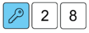
2. Sul display viene visualizzato:

    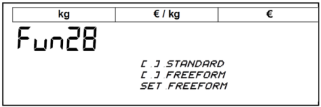

3. Spostarsi sull'opzione **FREEFORM** con il tasto  e attivarla premendo il tasto ENTER 
4. Spostarsi quindi sull'opzione **SET FREEFORM** con il tasto  e confermare premendo il tasto ENTER 
5. Sul display apparirà:

    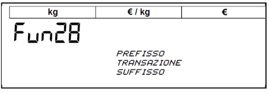

### Impostazione di prefisso, transazione e suffisso

1. Spostarsi sull'opzione **PREFISSO** con il tasto  e confermare premendo il tasto ENTER.
2. Verificare che il parametro sia **vuoto**; qualora non lo fosse, cancellarne tutto il contenuto. Confermare premendo il tasto ENTER.
3. Spostarsi sull'opzione **TRANSAZIONE** con il tasto  e confermare premendo il tasto ENTER.
4. Impostare il seguente testo nel parametro (rispettando le lettere minuscole):

    ```
    r07n05o05s03
    ```

5. Confermare premendo il tasto ENTER.
6. Spostarsi sull'opzione **SUFFISSO** con il tasto  e confermare premendo il tasto ENTER.
7. Verificare che il parametro sia **vuoto**; qualora non lo fosse, cancellarne tutto il contenuto. Confermare premendo il tasto ENTER.
8. Al termine premere per due volte il tasto C per uscire dalla programmazione: 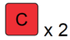

### Attivazione della stampa del QR Code

1. Dalla "Pagina Iniziale" richiamare la funzione **"Personalizza Stampe"**: 
2. Sul display viene visualizzato:

    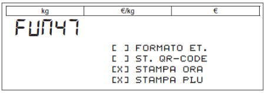

3. Spostarsi sull'opzione **ST. QR-CODE** con il tasto  e attivarla premendo il tasto ENTER.
4. Al termine premere per due volte il tasto C per uscire dalla programmazione.

## Configurazione PLU

!!! note "Quando serve"
    Fare riferimento a questa programmazione solo nel caso in cui non ci sia un gestionale collegato alla bilancia per la generazione dell'anagrafica PLU. Se l'anagrafica viene inviata da KeepUp Smart, vedi [Anagrafica da cassa a bilance](anagrafica-introduzione.md).

1. Dalla "Pagina Iniziale" richiamare la funzione **"PLU"**: 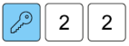
2. Sul display viene visualizzato:

    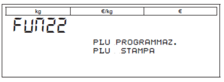

3. Selezionare **"PLU PROGRAMMAZ."** premendo il tasto ENTER. Sul display viene visualizzato:

    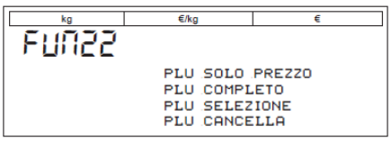

4. Utilizzare i tasti 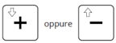 per navigare all'interno del menu.
5. Selezionare **"PLU COMPLETO"** e confermare premendo il tasto ENTER. Sul display viene visualizzato:

    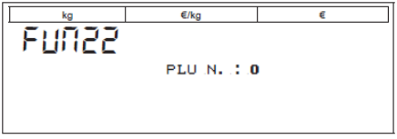

6. Digitare il codice del PLU (esempio "1") e confermare premendo ENTER. Sul display viene visualizzato:

    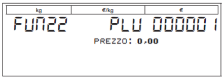

7. Verranno richiesti in sequenza tutti i dati dell'articolo: digitarli uno alla volta confermando con il tasto ENTER. In particolare:

    | Dato | Valore |
    |------|--------|
    | **Tipo PLU** | **KG** per un PLU "pesato"; **PZ** per un PLU "a corpo" |
    | **Barcode** | Selezionare il formato **LPPPPPPIIIIIK** |

8. Al termine della programmazione del PLU il display tornerà alla richiesta del numero PLU: è quindi possibile procedere inserendo un nuovo numero di PLU seguito da ENTER, oppure premere il tasto C per uscire.

!!! warning "Tipo PLU NG"
    Non selezionare la tipologia **NG** (PLU "negativo"): non è compatibile con la generazione del QR Code.

!!! tip "Modifiche rapide"
    - In un impianto già installato, il 99% della programmazione quotidiana si riduce alla semplice modifica del prezzo degli articoli già presenti in memoria: tramite la voce di menu **"PLU SOLO PREZZO"** è possibile modificare rapidamente solo tale dato, lasciando inalterati i restanti.
    - Per modificare un singolo dato (descrizione, tipo, ecc.) di un PLU esistente è possibile utilizzare la voce di menu **"PLU SELEZIONE"**, che permette di scegliere direttamente quale dato modificare.

## Configurazione Barcode generale

!!! note "Quando serve"
    Questo passaggio si rende necessario nel momento in cui l'anagrafica degli articoli viene trasmessa alla bilancia tramite un gestionale esterno.

1. Dalla "Pagina Iniziale" richiamare la funzione **"Barcode"**: 
2. Sul display viene visualizzato:

    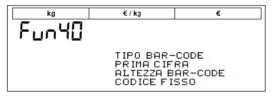

3. Premere il tasto ENTER.
4. Spostarsi sull'opzione **LBBBBBBIIIIIK** con il tasto  e attivarla premendo il tasto ENTER.
5. Premere per due volte il tasto C per uscire dalla programmazione.

## Operazioni aggiuntive

Per evitare vendite a prezzo libero, sconti manuali sugli articoli e operazioni in detrazione che potrebbero compromettere la lettura del QR Code in cassa, è necessario bloccare la possibilità di eseguire tali operazioni.

### Vendita solo tramite PLU

1. Dalla "Pagina Iniziale" richiamare la funzione: 
2. Spostarsi sull'opzione **"SOLO PLU"** con il tasto  e attivarla premendo il tasto ENTER.
3. Premere C per uscire dalla programmazione.

### Disattivazione di sconti e resi per operatore

1. Spostarsi nella funzione: 
2. Sul display viene visualizzato:

    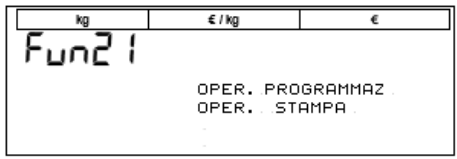

3. Accedere alla programmazione premendo il tasto ENTER.
4. Inserire il codice dell'operatore (es. Op. 1) e confermare.
5. Disattivare con ENTER le opzioni **"SCONTO"** e **"RESO"**.
6. Premere C per uscire dalla programmazione.

!!! warning "Attenzione"
    Ripetere questa programmazione per tutti gli operatori che verranno utilizzati in fase operativa.
