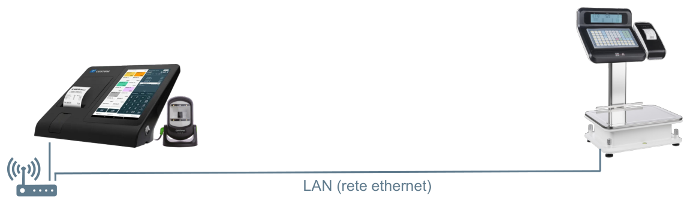
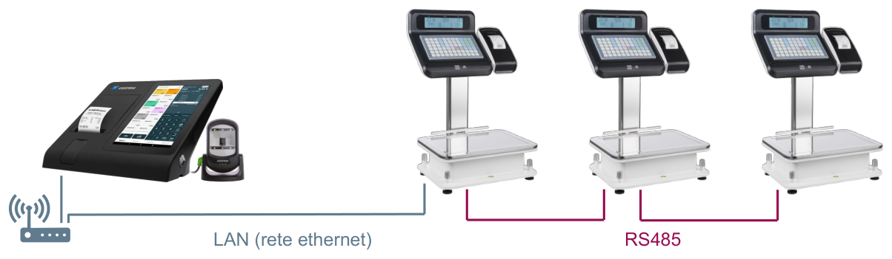
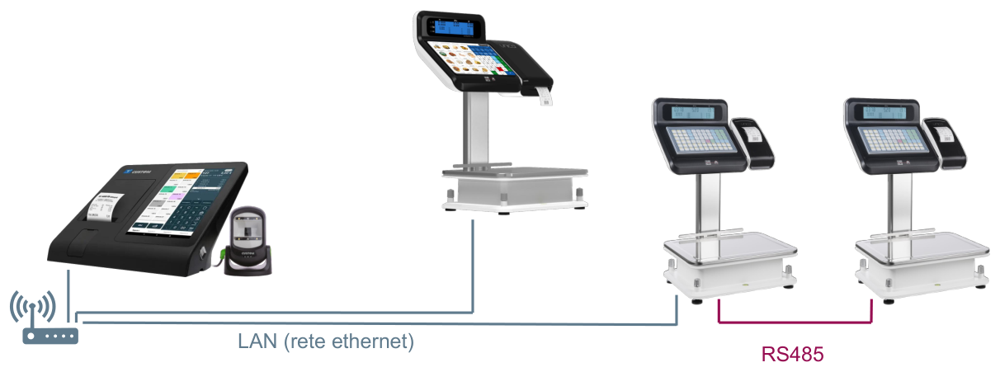
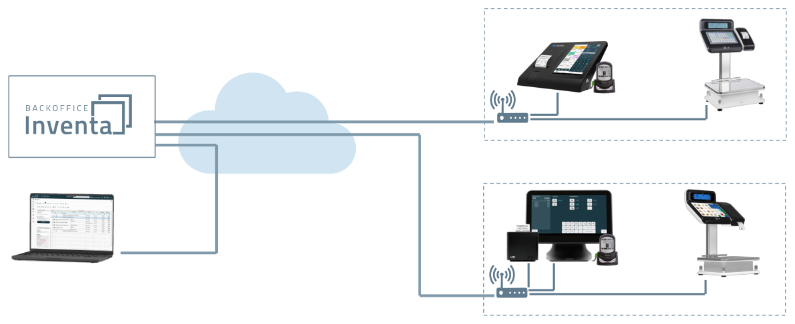

# Scenari di applicazione

## Scenario 1 – Negozio con una cassa e una bilancia

La cassa con KeepUp Smart e la bilancia Unica sono collegate alla stessa rete locale (LAN Ethernet).

## Scenario 2 – Negozio con una cassa e più bilance "a passaggio"

La cassa comunica in rete locale con una bilancia; le bilance sono collegate tra loro tramite RS485 per lo scontrino "a passaggio".

!!! note "Nota"
    Nella modalità "a passaggio" KeepUp Smart invia i dati alla sola bilancia master, che allinea le slave: vedi [Introduzione e sincronizzazione](anagrafica-introduzione.md).

## Scenario 3 – Negozio con una cassa e più bilance (più banchi o modelli diversi)

La cassa raggiunge in rete locale bilance di banchi o modelli differenti; alcune bilance possono essere a loro volta collegate tra loro in RS485.

## Scenario 4 – Più negozi con Inventa Backoffice

Inventa Backoffice gestisce da remoto più punti vendita, ciascuno con la propria cassa e le proprie bilance in rete locale.

!!! tip "Approfondimento"
    I vantaggi dell'abbinamento sono descritti nella pagina [Integrazione con Inventa Backoffice](inventa-backoffice.md).
